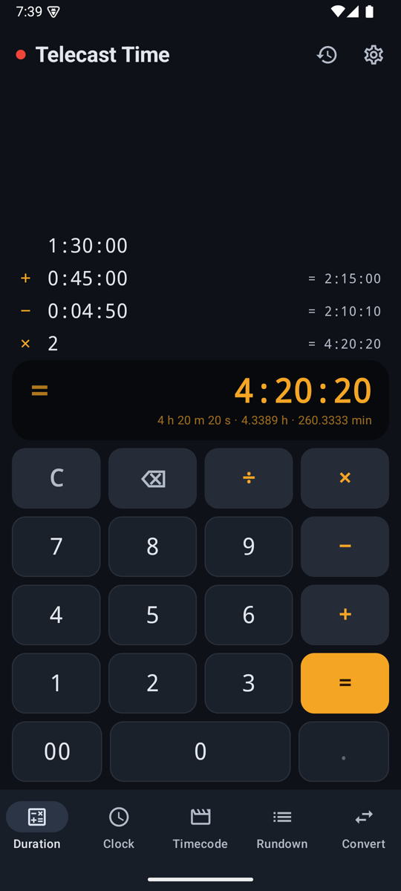
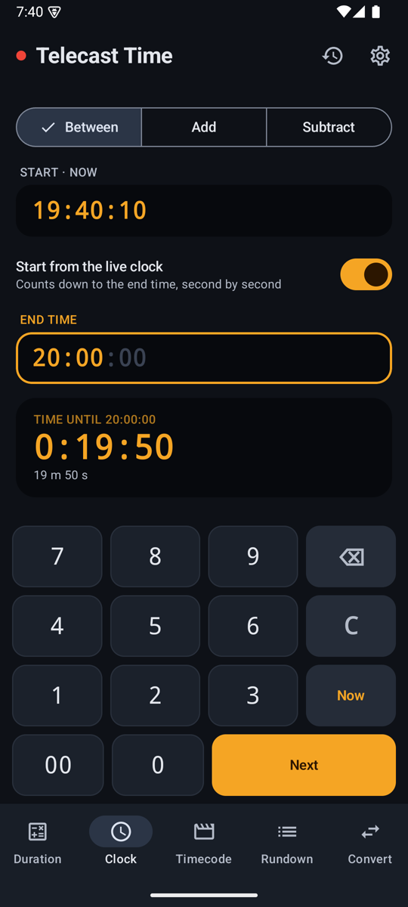
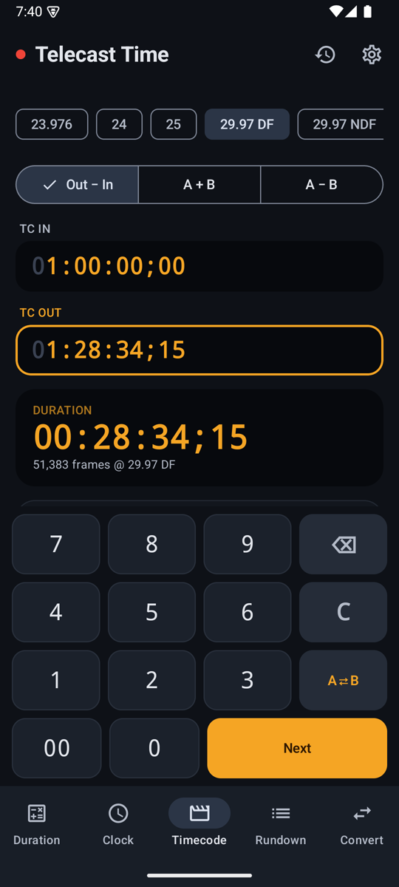

# Telecast Time

A time calculator built for broadcast: control rooms, edit suites, and anyone timing a show.

**[⬇️ Download the latest APK](../../releases/latest)**

  
  
  
  
  

## What it does

- **Duration tape.** Add and subtract durations like an adding machine, and multiply or divide them by a number. Type `13000` for 1:30:00. Each line shows the running total.
- **Clock.** Find the time between two times of day, even past midnight, or add or subtract a duration from a time. Turn on *live clock* for an on-air countdown that updates every second. 12- or 24-hour.
- **Timecode.** Frame-accurate `HH:MM:SS:FF` at 23.976, 24, 25, 29.97 DF/NDF, 30, 50, 59.94 DF/NDF and 60 fps. Out − In durations, A + B, A − B, frame counts and real time.
- **Rundown.** List your segments (headlines, packages, breaks) and see when each one goes to air, the off-air time, and whether the show runs over or under its slot. You can share it as text.
- **Convert.** See one value in milliseconds, frames, seconds, minutes, hours, days and weeks, and as timecode.
- **History.** Sums are saved automatically and other results with one tap. Tap any entry to copy it.
- Light and dark themes, works offline, and updates itself from this page.

## Install

1. Download `telecast-time.apk` from the [latest release](../../releases/latest).
2. Open it on your phone and allow installing from this source if Android asks.
3. Needs Android 8.0 or newer.

> Coming from the old *Time Calculator* (v2, the WebView version)? It is a different app, so you can keep both or uninstall the old one. Later updates arrive inside Telecast Time itself.

---

Made by **Abdullah Al Fahim**.
