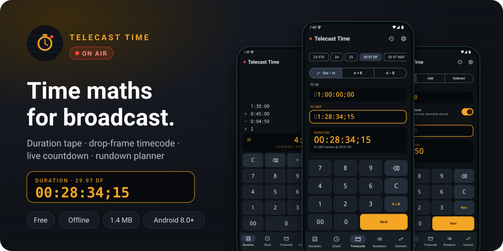
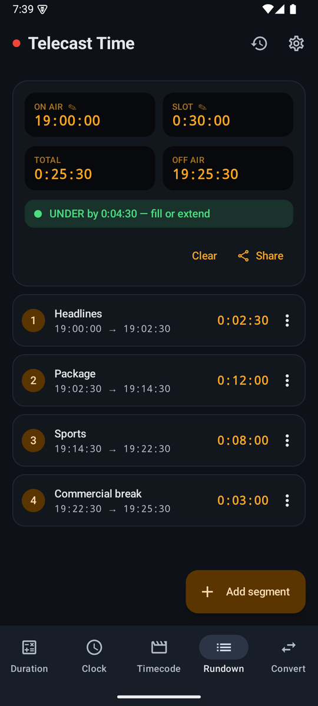
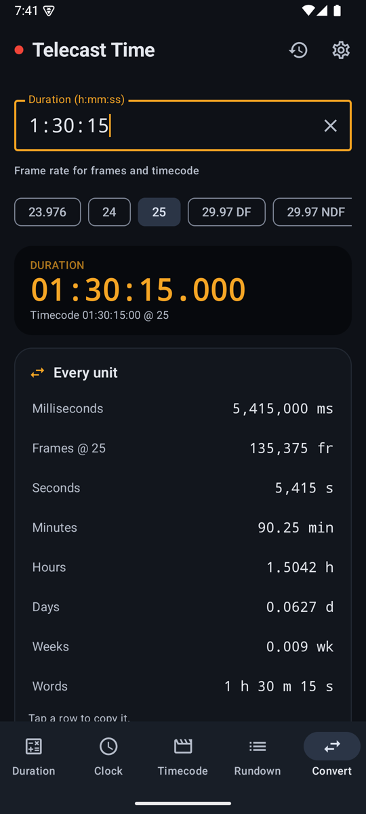
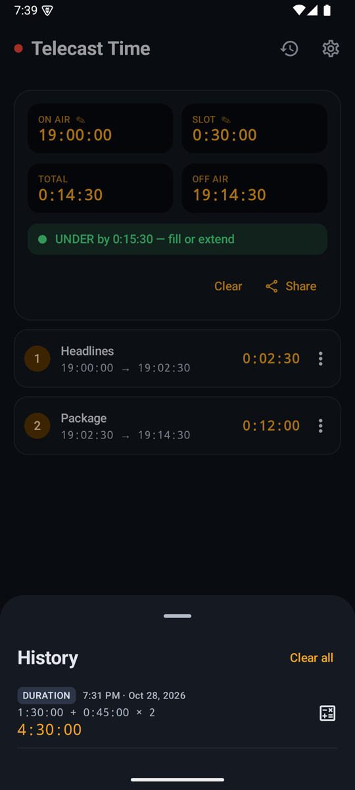
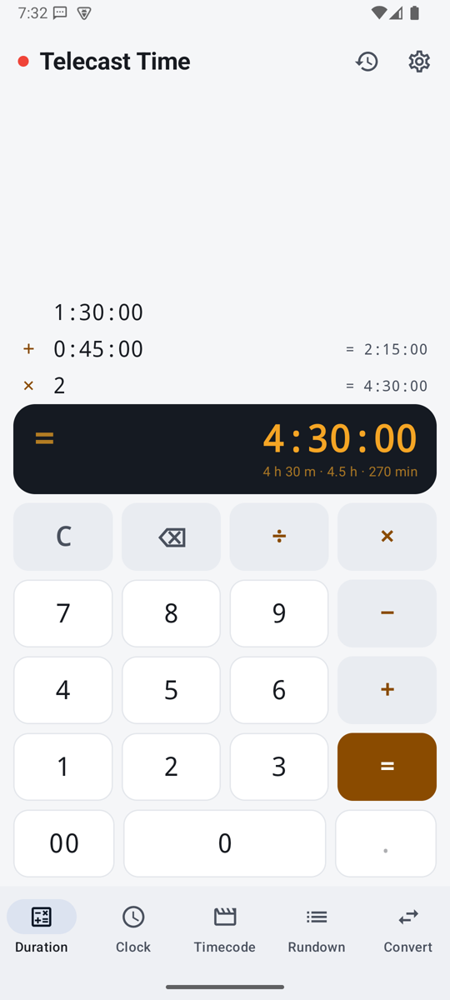
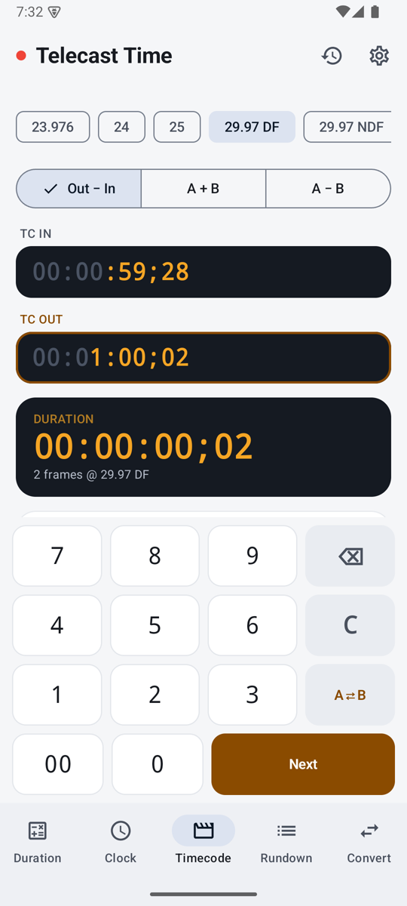
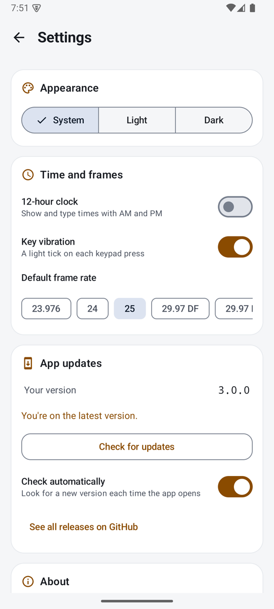

 

Free · no ads · no account · Android 8.0 or newer · about 1.4 MB

  

    

---

## What is Telecast Time?

A calculator for the times you work with in broadcast. Add up the length of a show, find out how long until you're on air, subtract one timecode from another at 29.97 drop-frame, or plan a rundown and see whether it fits the slot.

It's made for master control rooms, edit suites, newsrooms, and anyone else who times a programme. It runs entirely on your phone, with no account and no ads, and works without the internet.

## Screenshots

<table>
  <tr>
    <td align="center"> <b>Duration tape with running totals</b></td>
    <td align="center"> <b>Frame-accurate drop-frame timecode</b></td>
    <td align="center"> <b>Live countdown to air</b></td>
  </tr>
  <tr>
    <td align="center"> <b>Rundown with over/under</b></td>
    <td align="center"> <b>One value in every unit</b></td>
    <td align="center"> <b>History saved on your phone</b></td>
  </tr>
  <tr>
    <td align="center"> <b>Light theme</b></td>
    <td align="center"> <b>2 frames across the drop</b></td>
    <td align="center"> <b>Settings and in-app updates</b></td>
  </tr>
</table>

## What's inside

| | |
|---|---|
| 🧮 **Duration tape** | Works like an adding machine for time. Add and subtract durations, multiply or divide by a number, and every line shows its running total. Tap ⌫ on an empty entry to pull the last line back and fix it. |
| ⏱️ **Clock** | How long between two times of day, even across midnight. Or a time plus or minus a duration, with "next day" or "previous day" when it crosses one. Fill a field with **Now** in one tap. |
| 🔴 **Live countdown** | Switch on *Start from the live clock* and the Clock screen counts down to your end time every second: "on air in 0:19:50". |
| 🎞️ **Timecode** | `HH:MM:SS:FF` maths: Out − In duration, A + B, A − B. Shows the result in frames and in real time, and tells you if a timecode can't exist at the chosen rate. |
| 🎬 **Every broadcast rate** | 23.976 · 24 · 25 · 29.97 DF · 29.97 NDF · 30 · 50 · 59.94 DF · 59.94 NDF · 60. Drop-frame timecode is written with `;` and skips the right frame numbers. |
| 📋 **Rundown** | Add segments such as headlines, packages, breaks and promos. See each one's on-air and off-air time, the total, and **OVER** or **UNDER** against the slot. Reorder, duplicate, and share the rundown as text. |
| 🔁 **Convert** | Type `90`, `1.5` or `1:30:00` and see it in milliseconds, frames, seconds, minutes, hours, days and weeks, plus as timecode. Tap any row to copy it. |
| 🕘 **History** | Duration sums are saved automatically, and other results are saved with one tap. Tap to copy, or reopen a sum on the tape and keep going. |
| 🌗 **Light and dark** | Follows your phone, or pick light or dark. Readouts use fixed-width digits so they don't jump while you type. |
| ⚙️ **Your way** | Choose a 12- or 24-hour clock, a default frame rate (25 fps out of the box), and whether the keys vibrate. |
| 🔄 **Updates itself** | When a new version is out, the app tells you and installs it in one tap. A red dot on the settings icon means an update is waiting. |
| 🔒 **Private** | No account, no ads, no tracking. History and rundowns never leave your phone. The internet is used only to check this page for updates, and you can turn that off. |

## Typing times

The keypads work the way broadcast equipment does, so you don't type colons.

| Where | You type | It reads | Why |
|---|---|---|---|
| Duration | `13000` | `1:30:00` | Digits push in from the right, like a calculator |
| Duration | `90` | `00:00:90` → 0:01:30 | Minutes and seconds may overflow; the maths handles it |
| Timecode | `100` | `00:00:01:00` | Pushes in from the right, like an edit suite's TC field |
| Clock | `1930` | `19:30:00` | Times of day fill from the left, the way you say them |
| Convert | `1:30` | 1 min 30 s | Colons work here too: `h:mm:ss` or `m:ss` |

## Install

1. Tap **Download now** above. The `telecast-time.apk` file downloads to your phone.
2. Open the file when it finishes.
3. If Android asks about installing from an unknown source, tap **Settings**, turn on **Allow from this source**, go back and tap **Install**.
4. Open **Telecast Time**.

> **Updates:** once it's installed, the app tells you when a new version comes out and updates from inside the app. You don't need to come back here or uninstall anything.
>
> **Had the old *Time Calculator* (v2)?** Telecast Time is a new app, so it installs alongside the old one. You can uninstall the old version.

## Questions

<b>What is drop-frame, and which rate should I pick?</b>

 

NTSC-based video runs at 29.97 frames per second, slightly slower than the 30 frames its timecode counts. Over an hour, non-drop timecode falls 3.6 seconds behind the clock. Drop-frame timecode fixes this by skipping frame numbers `;00` and `;01` at the start of every minute except every tenth minute, so the timecode keeps pace with real time. No pictures are dropped.

Bangladesh, India, most of Europe and much of Asia use **25 fps** (PAL), which has no drop-frame. That's the default. Change it in **Settings → Default frame rate**, or per calculation on the Timecode screen.

<b>Is the Out − In duration inclusive?</b>

 

No. Like an edit decision list, the Out point is the first frame *after* the clip, so `Out − In` is the clip's length. Add one frame yourself if your workflow counts the out frame.

<b>Does it need the internet?</b>

 

No. Every calculation runs on your phone. The only network use is a small check of this page for new versions, which you can turn off in **Settings → App updates**.

<b>Is my data stored anywhere?</b>

 

Only on your phone. History, the rundown and your settings are kept in the app's private storage and are removed if you uninstall it.

## What's new

**3.0.0** rebuilt Telecast Time from scratch as a native app with the duration tape, timecode, live countdown, rundown, converter, history and in-app updates. See every version on the [releases page](https://github.com/abdullah-al-faahim/telecast-time-calculator-app/releases).

---

**Telecast Time** · made by **Abdullah Al Fahim**

Found a problem or have an idea? <a href="https://github.com/abdullah-al-faahim/telecast-time-calculator-app/issues">Open an issue</a>.

